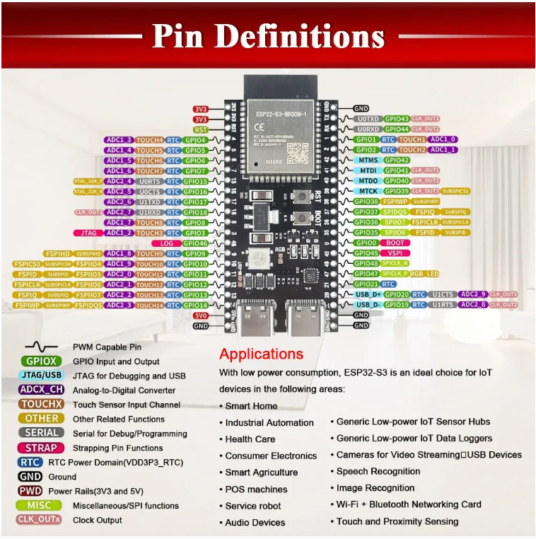
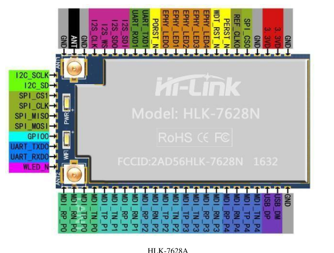

# 💾 ESP32 High-Speed SPI Flash Programmer (Serprog)

<div align="center">


<p align="center">
  <b>High-speed hardware SPI Flash programmer leveraging Espressif HW SPI peripherals for in-circuit unbricking and burning U-Boot bootloaders onto MT7628 / HLK-7628N and standard 3.3V NOR SPI flash.</b>
</p>

---

</div>

## 📌 Overview

This project turns any member of the **Espressif ESP32 MCU family** (ESP32-S3, Classic ESP32, ESP32-C3) into a dedicated high-speed SPI Flash Programmer. By implementing the native **Serprog** protocol, it communicates seamlessly with the industry-standard **Flashrom** utility on Linux over native USB-CDC or high-speed UART.

While universally compatible with any 3.3V SPI NOR Flash (such as the Winbond `W25Qxx` series), this repository includes battle-tested layouts and commands specifically tuned for unbricking and burning custom bootloaders onto the **HLK-7628N** (MediaTek MT7628) Wi-Fi router module.

---

## ✨ Key Features

* **Universal ESP32 Compatibility:** Native support across ESP32-S3 (USB-CDC), ESP32 (UART), and ESP32-C3.
* **Hardware SPI Acceleration:** Direct utilization of native hardware SPI channels capable of clock rates up to **80 MHz**.
* **In-Circuit Flashing:** Flash NOR memories without desoldering by holding the host SoC in a hardware reset state (`PORST_N` to `GND`).
* **Surgical Partition Burning:** Includes layout padding recipes to rewrite only the bootloader section (`0x00000000 - 0x0001ffff`) in under 2 seconds while preserving art/calibration and NVRAM partitions.

---

## 🛠 Hardware Wiring & MCU Pinouts

<div align="center">

| Target MCU | Linux Device | Install Target | Set-Target Command | Pinout (MISO / MOSI / CLK / CS) |
| :--- | :--- | :--- | :--- | :--- |
| **ESP32-S3** (e.g. S3-WROOM-1) | `/dev/ttyACM0` | `./install.sh esp32s3` | `idf.py set-target esp32s3` | **IO13** / **IO11** / **IO12** / **IO10** |
| **ESP32** (Classic WROOM-32) | `/dev/ttyUSB0` | `./install.sh esp32` | `idf.py set-target esp32` | **IO18** / **IO23** / **IO19** / **IO13** |
| **ESP32-C3** | `/dev/ttyACM0` | `./install.sh esp32c3` | `idf.py set-target esp32c3` | **IO2** / **IO7** / **IO6** / **IO10** |

</div>

> ⚠️ **Important:** ESP32 GPIO logic operates at **3.3V**. Ensure the target flash chip operates at 3.3V. If programming a 1.8V chip, an active bidirectional level converter is strictly required.

---

## 📸 Hardware References

<div align="center">

| ESP32-S3 Pinout Reference | HLK-7628N Target Module Layout |
| :---: | :---: |
|  |  |

</div>

---

## 🚀 Installation & Firmware Flashing

### 1. Install System Dependencies
```bash
sudo apt update
sudo apt install git wget flex bison gperf python3 python3-pip python3-venv \
    cmake ninja-build ccache libffi-dev libssl-dev dfu-util libusb-1.0-0 flashrom -y
```

### 2. Set Up ESP-IDF
```bash
mkdir -p ~/esp && cd ~/esp
git clone --recursive -b v5.2.2 https://github.com/espressif/esp-idf.git
cd esp-idf
./install.sh esp32s3
```

### 3. Build & Flash the Serprog Firmware
```bash
# Export IDF environment
. ~/esp/esp-idf/export.sh

# Clone serprog source
cd ~/esp
git clone https://github.com/thisiseth/esp32-serprog.git
cd esp32-serprog/src/serprog

# Configure and compile
idf.py set-target esp32s3
idf.py build

# Flash programmer firmware to ESP32
sudo chmod 666 /dev/ttyACM0
idf.py flash -p /dev/ttyACM0
```

---

## ⚡ Flashing Bootloader to Target (e.g. HLK-7628N)

### 1. Prepare 32MB Padded Bootloader Image
To safely flash only the bootloader sector without damaging factory RF calibrations:
```bash
# Create 32MB empty flash image (filled with 0xFF)
python3 -c "open('full_32m_uboot.bin', 'wb').write(b'\xff' * 33554432)"

# Overlay bootloader at the beginning
dd if=uboot.bin of=full_32m_uboot.bin conv=notrunc

# Define partition boundaries
echo -e "0x00000000:0x0001ffff bootloader\n0x00020000:0x01ffffff remaining" > layout.txt
```

### 2. Connect and Flash via Flashrom
Ensure the target SoC's reset pin (`PORST_N`) is connected to **GND**:
```bash
# 1. Probe SPI Flash connectivity
sudo flashrom -p serprog:dev=/dev/ttyACM0:115200,spispeed=8M

# 2. Burn the bootloader partition (~2 seconds)
sudo flashrom -p serprog:dev=/dev/ttyACM0:115200,spispeed=8M \
    -c "W25Q256FV" -l layout.txt -i bootloader -w full_32m_uboot.bin
```

---

## 📄 License & Credits

This project is licensed under **GPL-3.0**. Built upon the open-source `serprog` protocol, `flashrom` community, and `esp32-serprog` implementation.
